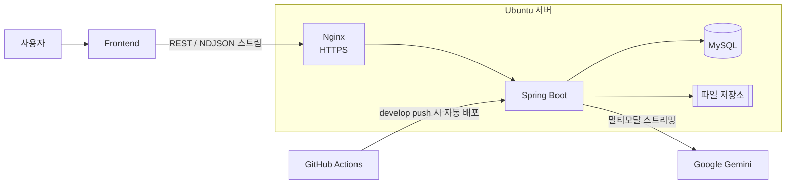

# 눈치코치 (NoonCo)

> **보이지 않는 배움까지, 이해할 수 있도록.**

시각장애 학습자가 표·그래프 같은 시각 자료를 직접 촬영하거나 PDF 강의자료를 올리면, AI가 자료의 구조와 의미를 분석해 음성으로 설명해 주는 학습 보조 서비스입니다.

멋쟁이사자처럼 14기 1호선톤 프로젝트

| 구분 | 링크 |
| --- | --- |
| 서비스 | https://noonco.vercel.app |
| API 서버 | https://api.mingu.cloud |
| API 문서 (Swagger) | https://api.mingu.cloud/swagger-ui/index.html |
| Frontend 저장소 | https://github.com/Line1-Hackathon-team14/NoonCo-FE |

---

## 기획 배경

수업에는 그래프와 표가 자주 쓰이지만, 시각장애 학습자는 이미지 형태의 자료를 직접 확인하기 어렵습니다.

- 스크린 리더나 문자 인식(OCR)만으로는 그래프의 **추세**나 표의 **관계**까지 이해하기 어렵습니다.
- 사진을 찍을 때 조명이 어두운지, 자료가 화면 밖으로 잘렸는지 스스로 확인하기 어렵습니다.
- 그래서 촬영과 해석 모두 다른 사람의 도움에 기대게 됩니다.

눈치코치는 **촬영 → 분석 → 음성 해설**을 하나의 서비스로 묶어, 학습자가 혼자서도 시각 자료를 이해할 수 있도록 돕습니다.

## 대상 사용자

- **주 사용자**: 표와 그래프로 학습해야 하는 시각장애 학생
- **보조 사용자**: 가입과 초기 설정을 도와주는 보호자·학습 지원자 (별도 보호자 계정은 없음)

## 해설 생성 흐름

1. **자료 업로드**: FE가 촬영 이미지나 PDF를 올리면, 서버가 파일을 검증·저장하고 `materialId`를 돌려줍니다.
2. **해설 요청**: FE가 `POST /api/v1/materials/{materialId}/analyses`를 호출합니다.
3. **AI 분석**: 서버가 사용자의 난이도에 맞는 프롬프트와 원본 파일을 Gemini에 보냅니다.
4. **스트리밍 응답**: Gemini 응답을 받는 대로 요약 → 상세 순서의 NDJSON 이벤트로 FE에 전달합니다. FE는 이 텍스트를 브라우저 TTS로 읽어 줍니다.
5. **결과 저장**: 해설이 끝나면 제목·요약·상세를 저장해 학습 기록에서 다시 조회할 수 있게 합니다.

## 주요 기능

- **자료 업로드·검증**: 이미지(JPEG·PNG)와 PDF를 최대 5MB까지 받습니다. PDF는 30페이지 이하만 허용하고, 암호가 걸렸거나 손상된 파일은 저장하지 않습니다.
- **시각 자료 해설**: 표·그래프 사진을 AI가 분석해 자료 유형(선·막대·원 그래프, 표 등)과 제목을 판별하고, **요약**(한 번 탭)과 **상세**(두 번 탭) 해설을 만듭니다. 요약은 최대 350자로 서버에서 잘라 보냅니다.
- **PDF 강의자료 해설**: PDF 원본을 그대로 AI에 전달해 글·표·그래프·이미지를 함께 분석합니다. 문서 전체 **요약**(최대 600자)과, 표·그래프를 등장 순서대로 설명하는 **상세**(최대 3,000자)를 만듭니다.
- **실시간 스트리밍**: 해설을 NDJSON으로 조각 단위로 보내, 생성이 끝나기 전에 FE가 읽기 시작할 수 있습니다.
- **사용자 설정**: 난이도(쉬움 / 보통 / 어려움)와 말하기 속도를 계정별로 저장하고, 난이도는 해설 프롬프트에 반영합니다.
- **학습 기록**: 자료 목록(사진/PDF 필터, 페이지네이션)과 개수, 상세, 원본 파일 조회, 삭제(soft delete) API를 제공합니다.
- **인증**: 회원가입·로그인·로그아웃과 JWT 인증(Access / Refresh Token)을 제공합니다. Refresh Token은 해시로 저장하고, 재발급할 때마다 교체합니다.
- **안정성**
  - 기본 모델이 과부하(503)로 실패하면 예비 모델로 한 번 더 요청합니다.
  - 동시 실행 수를 넘는 요청은 `AI_BUSY`로, 제한 시간을 넘긴 요청은 `AI_TIMEOUT`으로 중단합니다.
  - 읽을 수 없는 사진은 `UNREADABLE`로 안내하고, 완료되지 않은 자료(실패·판독 불가)만 다시 해설을 요청할 수 있습니다.

## 시스템 아키텍처



- 해설 생성 API는 `application/x-ndjson`(한 줄에 JSON 하나)으로 응답합니다. 이벤트 순서는 `started → progress → meta → delta(요약 → 상세) → done`이며, 자세한 형식은 Swagger를 참고해 주세요.

## 기술 스택

| 구분 | 기술 |
| --- | --- |
| Backend | Java 21, Spring Boot 4.1.2, Spring Security, Spring Data JPA, Bean Validation, Lombok |
| Auth | JWT (jjwt) |
| AI | Google Gemini (`google-genai` SDK) |
| File | Apache PDFBox (PDF 페이지 수 확인) |
| Database | MySQL |
| API 문서 | springdoc-openapi (Swagger UI) |
| Infra | Ubuntu, Nginx, systemd, Let's Encrypt (certbot) |
| CI/CD | GitHub Actions |
| Build | Gradle |

## 로컬 실행 방법

### 요구 사항

- JDK 21
- MySQL 8

### 1. DB 준비

```bash
mysql -u root -p -e "CREATE DATABASE noonco"
mysql -u root -p noonco < docs/schema.sql
```

서버는 `ddl-auto=validate`로 실행되어 테이블을 자동으로 만들지 않으므로, [`docs/schema.sql`](docs/schema.sql)로 스키마를 먼저 만들어야 합니다.

### 2. 환경 변수 설정

```bash
cp .env.example .env
```

`.env`에 최소한 아래 값을 채웁니다. 나머지 항목의 설명은 `.env.example`의 주석을 참고해 주세요.

| 키 | 설명 |
| --- | --- |
| `DB_URL`, `DB_USERNAME`, `DB_PASSWORD` | MySQL 접속 정보 |
| `JWT_SECRET` | JWT 서명 키 (32바이트 이상, 예: `openssl rand -base64 48`) |
| `LLM_PROVIDER` | `fake`: Gemini 없이 예시 응답 사용 (API 키 불필요) / `gemini`: 실제 Gemini 호출 |
| `GEMINI_API_KEY` | `LLM_PROVIDER=gemini`일 때 필수 |

### 3. 실행

```bash
./gradlew bootRun
```

실행 후 http://localhost:8080/swagger-ui/index.html 에서 API를 확인할 수 있습니다.

### 테스트

```bash
./gradlew test
```

테스트도 `.env`의 MySQL에 연결하므로, 위 1~2단계를 먼저 마쳐야 합니다.

## 산출물

- ERD: [ERD Cloud](https://www.erdcloud.com/d/TQziTgJE95rYmhrBo)

## 팀원

| 이름 | 역할 |
| --- | --- |
| 이준호 | Backend |
| 이민구 | Backend |
|김나연 | AI|
| 박현지 | Frontend |
| 신연아 | Frontend |
| 고서영 | Design |

